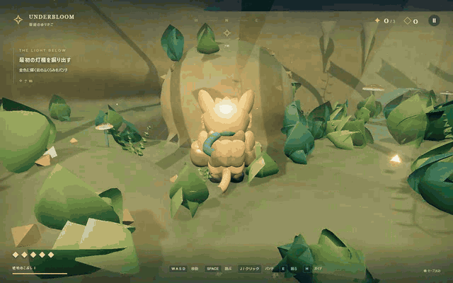

# UNDERBLOOM — 地底の灯

## [ゲームをプレイ](https://onego15.github.io/bananza-gpt/)



**岩を砕き、道をひらく。** 琥珀のこぶしを持つ冒険家「ルウ」が三つの灯種を探す、ブラウザ向け三人称3Dアクションアドベンチャーです。以前のGodot試作から新しいWebGL実装へ作り直しました。

[実プレイ MP4](docs/demo.mp4) · [タイトル](docs/title.png) · [ルウ](docs/ruu.png) · [晶洞](docs/grotto.png) · [神殿](docs/sanctum.png)

GIF・MP4はChromeで通常のキー操作中の実際のゲーム画面とHUDを、Playwrightの標準動画機能で録画したものです。AI生成のプレイ映像ではありません。収録前に開始位置を発掘現場へ配置し、録画中の移動・攻撃・破壊は実際のキー入力です。収録は `tests/record-demo.mjs`、変換は `tests/encode-demo.py`。MP4は同じ実フレームから作った無音動画です。ゲーム本体には効果音と環境音楽があります。

## 特徴と進行

- **翠緑のゆりかご**：金色の岩を砕き、灯種を発掘。床の下にも秘密の地下室があります。
- **星降る晶洞**：北の壁にトンネルを開け、二つの鳴石をパンチで共鳴させます。鉱脈の中の灯種を探してください。
- **暁の地底神殿**：衝撃波をジャンプで避け、露出した核を叩いて守護者を鎮めます。三つの灯種を集め、奥の円環でFを押すとエンディングです。その後も探索できます。
- 琥珀片と灯種でパンチが成長。琥珀片20個・50個で体力が増えます。隠された宝箱は三つ。三つの道しるべで回復・保存できます。
- 自由な地形掘削、溜めパンチ、床掘り、天井攻撃、空中叩きつけ、破片・粉塵・衝撃波・ヒットストップ・合成音・画面振動を組み合わせています。

## 操作

| 操作 | 入力 |
| --- | --- |
| 移動 / ダッシュ | WASD・矢印 / Shift |
| ジャンプ | Space（短押し・長押しで高さ変化） |
| パンチ・連続攻撃 | 左クリック / J（長押し可） |
| 床を掘る / 空中叩きつけ | E |
| 天井への上向きパンチ | K |
| 溜めパンチ | Lを長押しして離す |
| カメラ / 距離 | マウス・右ドラッグ・Q/C / ホイール |
| 道しるべで保存 / 最後の祭壇 | F |
| 地図 / 操作ガイド | Tab・M / H |
| 最後の道しるべへ帰還 | R |
| 一時停止・再開 | Esc / 右上のメニュー |

開始時にマウス捕捉を試みます。利用できない環境では右ドラッグまたはQ/Cを使用できます。セーブは同じブラウザ・同じオリジンの `localStorage` に保存されます。「はじめから」でこのゲームの保存を消去します。

## 起動

Node.js 20.19以降と、WebGL 2対応のデスクトップChrome / Edgeを推奨します。

```sh
npm ci
npm run dev
```

表示されたローカルURLを開きます。本制作環境では `http://127.0.0.1:5173/bananza-gpt/` です。

```sh
npm run build
npm run preview
```

本番用ファイルは `dist/`。任意の静的HTTPサーバーで配信できます。HTMLの `file://` 直接起動は非対応。実行時の外部CDN・API・画像取得・ログインは不要です。

## GitHub Pagesでの公開

[GitHub Pagesで公開済み](https://onego15.github.io/bananza-gpt/)。公開URLでの通常起動・描画・移動・掘削・保存、およびボス撃破からエンディングまでを実ブラウザで確認しました。結果・スクリーンショット・生ログは [公開記録](docs/DEPLOYMENT.md) にあります。

`vite.config.js` の `base: '/bananza-gpt/'` により、JS・CSSをリポジトリのサブパスから読み込みます。3Dモデル・地形・音源はコード生成で、外部アセットサーバーは不要です。セーブはプレイしているブラウザのlocalStorageに保存されます。

`.github/workflows/pages.yml` は `main` へのpush（README・docsのみの変更を除く）または手動実行で、Node.js 22 / `npm ci` / `npm test` / `npm run build` を実行し、`dist/` をGitHub Pagesへデプロイします。公開用トークンをソースに保存する必要はありません。

再設定が必要な場合は、リポジトリの **Settings → Pages → Build and deployment → Source: GitHub Actions** を選び、Actionsの「Build and deploy game to Pages」を実行してください。Actions自体が無効な場合はSettings → Actionsで有効化します。ワークフローには公開ジョブの `pages: write` と `id-token: write` が必要です。

ローカルのビルド確認は `npm run preview` の後、`http://127.0.0.1:4173/bananza-gpt/` を開いてください。ブラウザテストには環境変数 `TEST_URL` でこのURLまたは公開URLを指定できます。

## 技術・地形破壊の方式

JavaScript / Three.js **0.180.0** / WebGL 2 / Vite **6.1.0**。Three.js上に専用の地形・操作・戦闘・進行システムを実装しています。

**97×63×177、格子間隔0.75の連続密度場**で洞窟・斜面・岩柱・鉱脈を表現。球形CSG差分で地形を削り、ゼロ等値面を **Marching Tetrahedra** でポリゴン化します。立方体を並べて消す描画ではありません。影響範囲の12セル単位チャンクだけを再生成します。

通常パンチは入口と奥をつなぎ、足元を保つ高さ制限付きの掘削。E・K・空中Eは上下にも自由な球形掘削です。材質で掘削半径と演出を変更します。衝突も同じ密度場を三線形補間し、密度勾配、カプセル表面42点の実体プローブ、移動サブステップで解決するため、削った形が移動に反映されます。底部と道しるべの基壇には保護層があります。周囲を掘り尽くしても帰還地点の足場は残ります。保存時は掘削履歴を記録し、ロード時に再適用します。

カメラは地形を調べて追従距離を調整し、近い岩だけを表示上切り欠きます。装飾による遮蔽にも対応。衝突データは変更しません。

主人公と敵の曲面モデル、階層アニメーション、顔・耳・爪・背甲・布、曲面の植物、シダ、キノコ、鉱石、ベベル付き古代建築を手続き生成。岩肌の3Dノイズ・地層、素材粒子、霧、影、光の筋、ブルーム、ACESトーンマッピングを組み合わせました。静的装飾の材質別結合、葉のインスタンシング、エフェクト数制限、軽量画質モードを実装しています。音楽・効果音はWeb Audioによるオリジナル合成音です。

ソースは `src/terrain.js`、`mesher.js`、`physics.js`、`art.js`、`world.js`、`main.js`、`audio.js`、`ui.js`、`style.css` に分割しています。依存ライブラリとライセンスは [THIRD_PARTY.md](docs/THIRD_PARTY.md)。外部キャラクター・3Dモデル・画像・楽曲は使っていません。

## 品質改善の記録

初期実装を実際に描画・操作してから、以下を改善しました。

1. トンネル入口で足が止まる問題：単一球から入口と奥をつなぐ掘削へ変更。通常攻撃で足場を削り続ける問題も抑制。
2. カメラが頭に入り込む問題：最短距離、岩の局所切り欠き、装飾の遮蔽処理を追加。
3. 斜面で接地が途切れる問題：支持判定を追加。ジャンプ先行入力、コヨーテタイム、空中制御、短押しジャンプを調整。
4. 単調な外観：地形解像度を1.0から0.75へ向上。岩のうねり、地層、シダ、吊り植物、鍾乳石、岩、鉱脈、ベベル、ルーン、素材粒子を追加。明るさも再調整。
5. 攻撃と探索：発光軌跡、溜め攻撃、破片・粉塵・音、ボスの予兆と弱点時間、目的地マーカー、地図、日本語ガイドを追加。
6. 負荷：静的装飾を材質別に結合し、葉をインスタンス化。敵の更新距離とエフェクト数を制限。
7. 穴の上に古い接地が残る問題：密度を正確な距離と仮定する判定をやめ、カプセル表面から実際のゼロ等値面を調べる方式へ変更。床掘りの落下を回帰テスト化。
8. 帰還先の足場：道しるべの基壇を保護し、掘り尽くした後でも安全な足場に帰還できるよう調整。
9. 再保存で古い穴が失われる問題：ロードしたCSG履歴を保持。収集物、宝箱、倒した敵も保存するよう修正。
10. 公開先での負荷確認後、遠方の敵の動作更新だけでなく描画も省くよう変更。近くのモデル・アニメーションの品質は維持。

## テスト

実測結果と検証条件は [QA記録](docs/QA.md)。再現コマンド：

```sh
npm test
npm run build
npm run preview -- --port 4173
# 別の端末で。Chromeの場所が異なる場合はCHROME_PATHを設定。
node tests/playthrough.mjs
node tests/stress.mjs
node tests/quality.mjs
node tests/deployment.mjs
node tests/record-demo.mjs
python tests/encode-demo.py
```

GIF再生成にのみPythonのPillow・imageio-ffmpegが必要です。ゲーム実行には不要。ブラウザテストは専用の空のプロファイルを使用します。

## AIサービス・制作時間

| 項目 | 記録 |
| --- | --- |
| 使用AIサービス | OpenAI Codex デスクトップ |
| 正確なモデル名 | **未確認**。正確な実行モデルIDを取得できないため推測しません。 |
| 画像・動画生成AI | 未使用。GIF・MP4はゲームの実描画です。 |
| ゲーム制作開始 | 2026-10-26 00:11:51 JST（時刻ツールで確認） |
| 初回ゲーム制作完了 | 2026-10-26 08:42:24 JST（時刻ツールで確認、追加の公開依頼前） |
| ゲーム制作経過 | 8時間30分33秒。時計上の差（待機を含む）であり、AIの実計算時間ではありません。 |
| 追加の公開作業開始 | 2026-10-26 08:43:07 JST（時刻ツールで確認） |
| 初回Pages公開完了 | 2026-10-26 08:56:12 JST（GitHub Actions記録） |
| 最終公開検証完了 | 2026-10-26 09:36:52 JST（時刻ツールで確認） |
| 公開検証までの追加作業経過 | 53分45秒（公開依頼後の作業・待機を含む） |
| 開始から公開検証まで | 9時間25分1秒（時計上の差、AIの実計算時間ではありません） |
| 制作終了・公開記録の最終確定 | 2026-10-26 09:39:13 JST（時刻ツールで確認、最終Actions成功・公開ファイル再照合後） |
| 公開作業の総経過 | 56分6秒 |
| 制作開始からの総経過 | 9時間27分22秒（待機を含む。記録ファイルのcommit・pushは確定後） |

公開先の検証日時と作業経過は [公開記録](docs/DEPLOYMENT.md) に記録しています。ゲーム制作と追加の公開作業を分けて記録し、検証後に記録ファイルをcommit・pushしています。

## 既知の問題・未完成部分

- 一般プレイヤーによる**15〜30分のプレイ時間は未確認**です。座標を知る自動操作では探索を省略して約1分で進行でき、人間の初見プレイ時間とは異なります。小規模な三エリアで、商業製品と同等の量・総合品質を達成したとは主張しません。
- 独自の手続き生成モデルです。DCC制作の高精細モデル、モーションキャプチャー、音声演技はありません。
- 細かな掘削縁には三角形の輪郭が見える場合があります。崩落・流体・物理的な支えの計算はありません。切り欠きカメラでは岩の断面に背景が見える場合があります。
- 地形の壁・床・天井・岩を掘削できます。装飾の遺跡・植物は描画物で、地形を削って足場を失うと非表示になります。装飾自体の厳密な物理衝突・破壊シミュレーションはありません。
- 高画質の大量掘削後の計測は約24.5〜85fpsと変動しました。公開先の初回試験は約24.5fpsで25fpsの基準を下回り、遠方の敵の描画を省く調整後の公開試験は約35.9fpsでした。常時60fpsは未達です。軽量画質の別比較では約27→34fpsに改善しましたが、60fpsは未達です。重い場合はメニューで切り替えてください。条件と生ログは公開記録を参照。
- 低性能GPU、スマートフォン、Safari・Firefoxは未検証。タッチ・ゲームパッド操作は未対応です。
- 任意の全掘削パターンでの進行を数学的に保証してはいません。Rによる帰還と進行物の非破壊化で復帰経路を確保しています。
- セーブはブラウザ・端末・オリジン単位。クラウド保存・エクスポートはありません。未回収の一時ドロップ・破片の位置は保存しません。
- インラインブラウザ観察ではプレビュー取得が制限されました。WebGL起動・入力・画面記録・QAは独立したローカルChromeで実施しています。

## 制作に使用した依頼プロンプト全文

<details>
<summary>依頼全文を表示</summary>

前回のものは捨てて新しく作り直します。

ドンキーコング バナンザに着想を得た、地形破壊を中心とする3Dアクションアドベンチャーゲームを制作してください。

ブラウザで快適に遊べる、商業インディーゲームのような完成度を目指してください。

**最も重視するのは、地形を豪快に破壊する爽快感、美しく作り込まれた3Dグラフィック、魅力的なキャラクター、未知の地下世界を探索する冒険感、優れたカメラワークと操作感です。**

今回は特に、十分な時間と労力をかけて作品を磨き上げてください。動くプロトタイプが完成しただけで作業を終了しないでください。

### 1. ゲームのコンセプト

- 三人称視点の3Dアクションアドベンチャー
- 主人公は強力なパンチや身体能力を持つオリジナルキャラクター
- 壁や床、岩などを破壊して自由に道を切り開く
- 地下世界を探索し、隠された宝物や新しいエリアを発見する
- 戦闘、探索、収集、ギミックを組み合わせる
- 15〜30分程度で一通りクリアできる規模を目指す

### 2. 地形破壊システム（最重要）

単に配置されたブロックを消すだけではなく、地形そのものを削ったり、穴を開けたり、トンネルを掘ったりできる仕組みを目指してください。

- パンチで壁や岩を破壊できる
- 地面を掘って下の空間へ進める
- 壁をくり抜いてトンネルを作れる
- 破壊した形状が地形に反映され、内部にも移動できる
- 土、岩、鉱石など、材質によって硬さや破壊演出が異なる
- 破壊した場所から宝物や隠された通路が現れる
- 破壊時の破片、粉塵、衝撃波、効果音、画面揺れで爽快感を生み出す

内部データにボクセルを使用しても構いませんが、見た目まで単純な立方体の集合にする必要はありません。

滑らかな地形表面と自然な造形を重視し、技術的に実現可能な最良の破壊システムを設計してください。

### 3. キャラクター・アクション

- 個性的で魅力のあるオリジナルの3D主人公
- 歩行、ダッシュ、ジャンプ、パンチ、空中攻撃
- 攻撃時に力強いモーションと明確なヒット感がある
- 地形破壊と戦闘のアクションが自然につながる
- 敵キャラクターにも独自の外見とアニメーションを用意する
- 操作の応答性がよく、思いどおりに動かせる
- 地形の凹凸や破壊後の穴でも移動が破綻しない

3Dモデルやアニメーションの品質を重視してください。コードだけで十分な品質を実現できない場合は、利用条件を遵守した高品質な公開アセットの活用も検討してください。

### 4. ステージ・冒険

複数の特色ある地下エリアを制作してください。

例：

- 緑豊かな地下遺跡
- 鉱石が輝く巨大洞窟
- 古代文明の眠る地底神殿

ただし、エリア数よりも密度と完成度を優先してください。

- 高低差のある立体的なマップ
- 地形を破壊することで発見できる秘密
- 地形破壊を活用した簡単な謎解き
- 宝物の収集と能力強化
- 印象的なギミックやボス戦
- 導入からエンディングまで遊べるゲーム進行

プレイヤーが想定外の方向から地形を破壊しても、可能な限りゲーム進行が破綻しないようにしてください。

### 5. グラフィック・アートディレクション

**今回、グラフィック品質は地形破壊の技術と同じくらい重要です。**

- 商業インディーゲームのような美しい3D世界
- 統一感のある色彩、造形、テクスチャ、ライティング
- キャラクターや敵は簡素な基本図形の組み合わせで完成扱いしない
- 地形には自然な凹凸や細かな装飾を用意する
- 植物、岩石、遺跡、鉱石などで世界に密度を持たせる
- 光、影、ブルーム、霧、パーティクルなどで豊かな空気感を表現する
- 破壊前後の地形が視覚的に自然につながる
- UI、効果音、BGMも世界観に調和させる

技術デモや試作品のような見た目ではなく、スクリーンショットを見ただけで遊びたくなる作品を目指してください。

### 6. カメラワーク・UI/UX

- 三人称カメラで主人公を自然に追従する
- 攻撃や地形破壊の際には適切なカメラ演出を行う
- 狭い洞窟でも壁に視界を遮られないようにする
- 地下へ掘り進む際にも主人公と周囲を見やすくする
- 大きな空間に出たときはカメラでスケール感を伝える
- 直感的な操作説明と分かりやすいUI
- 収集状況や目的地が自然に理解できる
- カメラ演出の派手さよりも操作性と視認性を優先する

### 7. 技術選定

- ブラウザで遊べることを必須とする
- ゲームエンジン、フレームワーク、プログラミング言語は自由
- 必要ならWebGLやWebGPU、ボクセル地形、独自シェーダーなどを利用してよい
- 外部アセットはライセンスを遵守して利用可能
- パフォーマンスと地形破壊の自由度のバランスを考慮する
- 原作のキャラクター、音楽、マップ、固有デザインはコピーせず、オリジナル作品とする

### 8. 品質改善・自律制作（最重要）

**基本的なゲームが動くようになっても、そこで完成と判断しないでください。**

初期実装後に、グラフィック、キャラクターアニメーション、地形破壊、カメラ、操作感、ゲームバランスを改善する工程を必ず設けてください。

- 実際にブラウザで起動し、スクリーンショットやプレイ映像を確認する
- グラフィックが簡素な場合は、アセット、モデリング、ライティング、描画処理を改善する
- 地形破壊の気持ちよさを繰り返し検証する
- 主人公の移動と攻撃が快適になるよう調整する
- 問題の発見、修正、再テストを繰り返す
- 制作速度よりも最終品質を優先する
- 可能な限り、利用可能な作業時間を品質改善にも十分に活用する
- コンテンツ量を増やすより、完成度の高い体験を優先する

**特に、見た目が簡素な状態や、地形破壊が物足りない状態で完成と判断しないでください。**

私への途中確認や質問は不要です。利用可能なツール・作業時間・実行予算の範囲で自律的に制作してください。

### 9. テスト・品質保証

可能な限り実際にプレイし、以下を検証してください。

- 通常移動、ジャンプ、パンチが正常に機能する
- 壁・床・天井を破壊できる
- 破壊後の地形に適切な当たり判定が反映される
- トンネルを掘って通り抜けられる
- 地形破壊後にキャラクターが埋まったり落下し続けたりしない
- 大量の地形破壊後も快適なフレームレートを維持する
- 想定外の方向から探索しても進行不能にならない
- リトライ、セーブ、ステージ遷移が正常に機能する
- ゲーム開始からエンディングまで到達できる

単純な操作だけでなく、連続した地形破壊や特殊な角度からの攻撃など、境界条件も検証してください。

### 10. GitHub README・制作記録

README.mdには次の内容を含めてください。

1. ゲームタイトルと概要
2. 実際のゲームプレイを録画した10〜15秒程度のGIFアニメーション
   - `docs/demo.gif` に配置してREADME冒頭に埋め込む
   - 主人公のアクション、地形破壊、冒険シーンを収録
   - 可能ならMP4動画も保存する
3. ゲームの特徴・操作方法
4. 起動方法
5. 使用したAIサービス名と正確なモデル名
6. 使用技術・ゲームエンジン
7. 地形破壊システムの実装方式
8. 制作開始・終了日時と経過時間
9. 実施したテストと結果
10. グラフィック・UI・ゲーム性について改善した内容
11. 制作に使用した、この依頼プロンプトの全文
12. 既知の問題と未完成部分

GIFは実際のゲームプレイを録画したものを使用してください。架空のプレイ動画で代用しないでください。

モデル名、制作時間、テスト結果など、確認できない情報は推測せず「未確認」と記載してください。

### 11. 完成条件

- ブラウザで正常にプレイできる
- 地形を破壊して新しい道を作れる
- 破壊と探索がゲームの中心的な楽しさになっている
- キャラクター、地形、エフェクトが視覚的に完成された品質である
- 気持ちのよい操作感とカメラワークを備える
- 最初から最後まで遊べる
- 品質改善とテストを実施している
- READMEとプレイGIFが用意されている

制約によって実現できなかった項目は、完成したと装わず正直に記録してください。

</details>

<details>
<summary>追加依頼：GitHubへのpush・GitHub Pages公開（全文）</summary>

完成したら

[https://github.com/onego15/bananza-gpt.git](https://github.com/onego15/bananza-gpt.git)

にpush


### 12. GitHub Pagesでの公開（必須）

完成したゲームをGitHub Pagesで公開し、ブラウザからすぐに遊べる状態にしてください。

- GitHub Pagesで動作する静的Webアプリとして構築する
- GitHub Actionsなどを利用して、ビルドとデプロイを自動化する
- リポジトリ名を含むサブパスで正常に動作するように設定する
- JavaScript、CSS、3Dモデル、テクスチャ、音声などのアセットが正しく読み込まれるようにする
- GitHub Pages上でもゲームの全機能が動作することを確認する
- READMEの冒頭に「ゲームをプレイ」リンクを掲載する
- ローカル環境だけでなく、公開先でも起動・描画・操作に問題がないことを検証する
- 公開に必要なGitHub側の設定や権限が不足している場合は、必要な手順をREADMEに明記する

公開URLは原則として以下の形式にしてください。

`https://onego15.github.io/<リポジトリ名>/`

ローカルで正常に動作するだけでは完成とせず、GitHub Pages上で実際に遊べることを最終目標としてください。

ただし、GitHubへのアクセス権限や実行環境の制約で公開できない場合は、公開完了と偽らず、デプロイ設定を準備したうえで残りの手順を明記してください。

### 最終成果物

- ブラウザで遊べるゲーム本体
- GitHub Pagesへのデプロイ設定
- 実際のプレイ動画を収録した `docs/demo.gif`
- GitHub PagesのプレイURLを掲載したREADME
- 制作プロンプト全文、使用モデル名、制作時間、テスト結果の記録

GitHub Pagesでの公開と公開先での動作確認まで、可能な範囲で自律的に進めてください。

</details>
